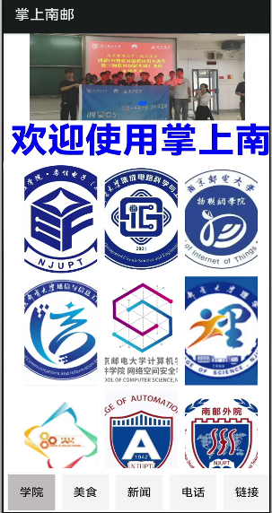
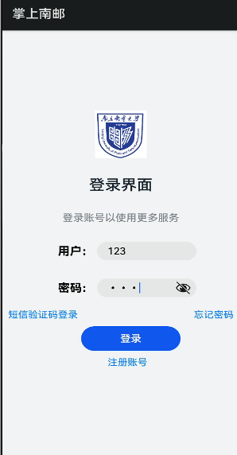
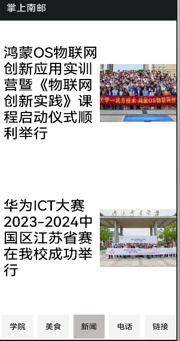
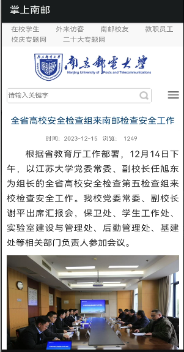
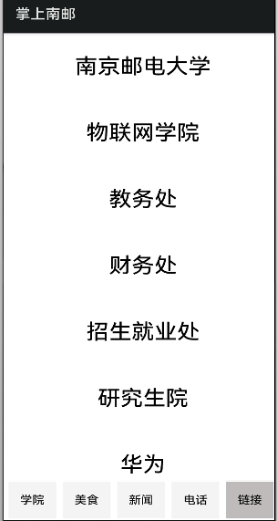
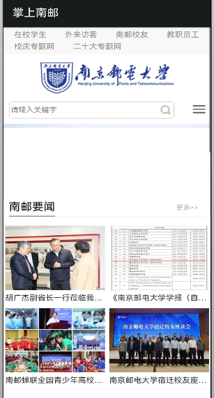

# 掌上南邮 · 手机端

> 基于 HarmonyOS ArkTS 的校园资讯与服务应用，覆盖学院介绍、美食、新闻、通讯录与友情链接。
>
> A HarmonyOS ArkTS campus app for NJUPT students, built with the API 8 FA model.


<p align="center">
  
  
  
  
</p>

## 项目简介

「掌上南邮」是南京邮电大学《物联网创新实践》课程项目，包含手机端与手表端两个鸿蒙应用。本仓库为**手机端**，基于 HarmonyOS API 8、ArkTS 声明式 UI 与 FA 模型实现，通过 `Swiper` + 自定义组件构建学院、美食、新闻、电话、链接五个功能页，并与华为云 FunctionGraph、Python Flask 服务进行数据交互。

项目已在 HarmonyOS 真机上完成功能验证。

> 配套仓库：[掌上南邮 · 手表端](https://github.com/MondayYYDS/palm-njupt-watch)

## 功能特性

| 模块 | 功能 | 技术要点 |
| --- | --- | --- |
| 启动页 | 5 秒自动进入登录页，支持点击“跳过” | `Stack`、`setTimeout`、`router.push` |
| 登录页 | 演示账号登录，失败提示 | `TextInput`、`@State`、`prompt.showToast` |
| 学院 | 顶部轮播图 + 跑马灯 + 学院宫格，点击进入详情页 | `Swiper`、`Marquee`、`Flex`、`ForEach` |
| 美食 | 7 张美食图片轮播，右侧分类与轮播联动 | `Swiper`、`@State`、自定义组件 |
| 新闻 | 新闻列表，点击进入 WebView 详情 | `@ohos.net.http`、`Web`、路由传参 |
| 通讯录 | 从云端获取通讯录，调用系统拨号 | 华为云 FunctionGraph、`@ohos.telephony.call` |
| 友情链接 | 链接列表，点击内嵌浏览 | Python Flask + natapp、`Web` |

## 界面预览

| 学院 | 登录 | 美食 | 新闻 |
| :---: | :---: | :---: | :---: |
|  |  |  |  |

| 新闻详情 | 友情链接 | 学院详情 |
| :---: | :---: | :---: |
|  |  |  |

## 技术栈

- **平台**：HarmonyOS API 8（FA 模型）
- **语言**：ArkTS / TypeScript
- **UI**：声明式 UI、自定义组件、`Swiper`、`Marquee`、`Flex`、`Scroll`、`Web`
- **网络**：`@ohos.net.http`
- **路由**：`@ohos.router`
- **系统能力**：`@ohos.telephony.call`
- **构建**：DevEco Studio 3.x + hvigor 2.4.2
- **后端**：华为云 FunctionGraph、Python Flask、natapp 内网穿透

## 项目结构

```text
palm-njupt-phone/
├── build-profile.json5          # 工程构建配置
├── hvigorfile.ts
├── package.json
├── entry/
│   ├── build-profile.json5
│   ├── hvigorfile.ts
│   └── src/
│       ├── main/
│       │   ├── config.json      # 应用配置、Ability、权限
│       │   ├── ets/MainAbility/
│       │   │   ├── app.ets
│       │   │   ├── common/
│       │   │   │   └── AppConfig.ets    # 后端地址与演示账号
│       │   │   ├── component/
│       │   │   │   ├── oneview.ets      # 学院
│       │   │   │   ├── twoview.ets      # 美食
│       │   │   │   ├── threeview.ets    # 新闻
│       │   │   │   ├── fourview.ets     # 通讯录
│       │   │   │   └── fiveview.ets     # 友情链接
│       │   │   ├── model/
│       │   │   │   ├── menu.ets
│       │   │   │   └── school.ets
│       │   │   └── pages/
│       │   │       ├── index.ets        # 启动页
│       │   │       ├── login.ets        # 登录页
│       │   │       ├── main.ets         # 主界面
│       │   │       └── schoolview.ets   # WebView 容器
│       │   └── resources/               # 图片、字符串、颜色
│       └── ohosTest/                    # Hypium 测试模板
├── docs/
│   ├── ARCHITECTURE.md
│   └── images/
├── CHANGELOG.md
├── CONTRIBUTING.md
└── LICENSE
```

## 快速开始

### 环境要求

- DevEco Studio 3.x
- HarmonyOS SDK API 8
- Node.js 14+（hvigor 依赖）
- HarmonyOS 真机或模拟器

### 导入与运行

1. 打开 DevEco Studio，选择 **File → Open**，打开本仓库根目录。
2. 进入 **Project Structure → Signing Configs**，勾选自动签名（需登录华为账号）。
3. 点击 **Sync Project**，等待 hvigor 依赖安装完成。
4. 连接真机或启动模拟器，点击 **Run**。

> 仓库中不包含任何签名证书、口令或本地 SDK 路径。首次导入后需自行配置签名。

### 后端配置

所有接口地址集中在 [`entry/src/main/ets/MainAbility/common/AppConfig.ets`](entry/src/main/ets/MainAbility/common/AppConfig.ets)。仓库中的地址为占位符，课程项目原实现使用华为云 FunctionGraph（学院、通讯录）和 Python Flask + natapp（新闻、美食、友情链接）。复现时请替换为自己的服务。

接口统一返回 JSON 数组，元素结构如下：

```json
[
  {
    "name": "学院 / 新闻 / 联系人名称",
    "link": "详情链接或电话号码",
    "action": "图片文件名或动作文案"
  }
]
```

| 常量 | 用途 | 课程项目实现 |
| --- | --- | --- |
| `COLLEGE_LIST_URL` | 学院列表 | 华为云 FunctionGraph |
| `CONTACT_LIST_URL` | 通讯录 | 华为云 FunctionGraph |
| `NEWS_LIST_URL` | 新闻列表 | Python Flask + natapp |
| `FOOD_LIST_URL` | 美食数据 | Python Flask + natapp |
| `FRIEND_LINKS_URL` | 友情链接 | Python Flask + natapp |

### 演示账号

课程演示账号为 `123 / 123`，仅用于本地体验。生产环境请接入真实鉴权与会话管理。

## 设计说明

页面结构、组件职责、路由表与数据流详见 [docs/ARCHITECTURE.md](docs/ARCHITECTURE.md)。

## 已知限制

- 课程项目，后端地址为占位符，需自建服务后才能完整体验。
- 基于 API 8 与 FA 模型；新项目建议迁移至 Stage 模型和更新的 HarmonyOS API。
- 登录为前端演示逻辑，没有真实会话、权限控制与数据持久化。
- 仓库仅包含 Hypium 测试模板，尚未覆盖 UI 自动化测试。

## 版本记录

见 [CHANGELOG.md](CHANGELOG.md)。

## 贡献

欢迎提交 Issue 和 Pull Request。提交前请阅读 [CONTRIBUTING.md](CONTRIBUTING.md)。

## 许可证

本项目基于 [Apache License 2.0](LICENSE) 开源。

Copyright © 2023-2026 Palm NJUPT Phone contributors

## 第三方资源

项目中使用的南京邮电大学校名、校徽、校园照片等素材仅用于课程演示，版权归原作者所有，**不包含在 Apache-2.0 许可范围内**。商业使用前请替换为已获授权的素材。详见 [NOTICE](NOTICE)。

## 致谢

- 南京邮电大学《物联网创新实践》课程
- 华为云 FunctionGraph、Python Flask、natapp
